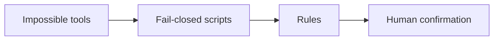

# Gainzbot

A fitness and nutrition coach that will not change your plan until the checks pass and you say yes.

## Who it is for

People who want training and food guidance with the safety checks in this repo.

## Four layers



Impossible tools: this is a platform setting, not something the code enforces. The platform stops the bot from posting, buying, or connecting a service on its own.

Fail-closed scripts: missing or bad input stops the plan.

Rules: plain English for the coach. Rules guide, checks enforce.

Human confirmation: you say a clear yes to the exact plan.

## Primary gate

The check-in checklist comes first. `red_flag_check.scan_check_in` has to pass before a plan is checked. `record_confirmation` has to cover that exact plan before anything is applied.

Safety bounds: 1,500/1,200 kcal floors, 10% weekly load cap, 200 kcal max step, no calorie or protein targets under 18, no training plan under 18, under 13 rejected. Readiness does not pass anyone under 18, even with a doctor's clearance or parental consent.

## What is built

- Shared input checks in `guardrails/validate.py`
- Red-flag check-in in `red_flag_check.py`
- Readiness screen in `readiness_screen.py`
- Plan bounds in `plan_check.py`
- Clear-yes confirmation in `record_confirmation.py`
- Chart data in `dashboard.py`. The builder only reads logs. A calorie target is left off when age or sex is missing, when the user is under 18, or when the target is below the floor (1,500 for men, 1,200 for women). When age is missing, or the user is under 18, no protein target is set. A protein target outside 1.6 to 2.2 g/kg is left off too. One log is not enough: the message stays "not enough data yet" until there are at least two logged days. Rows on one day still count as one day. Windows are 7, 28, 90, and 365 days. Weekly volume is sets times reps times kilograms per session.
- Trend review in `trend_review.py`. The last confirmed load or calorie change comes from one shared history. A new change waits until that confirmed change is at least 7 times 24 hours old in UTC. With nothing confirmed, load and calories do not move up. `apply` waits until `record_confirmation` covers that exact proposal. A missing age blocks calorie and protein proposals. Under 18, no calorie target is proposed. A stall follows the goal: cut or lose lowers calories, gain raises them, hold or no goal changes nothing.
- Morning check-in in `morning_checkin.py`. The keys are `sleep_hours`, soreness, energy, and stress. `sleep` is accepted as `sleep_hours`. Those scores set the day to push, normal, or easy. The confirmed session still comes from `data/week.json`. The session scales from the last confirmed load, stays inside the 10 percent cap, and waits 7 times 24 hours. With nothing confirmed, the load does not move up. A caller planned load is ignored. A rewritten week is built from that confirmed load, so a day sent in at 200 does not come back at 220. An earlier day is capped at the confirmed load, so 200 becomes 100 and a deload at 80 stays 80. Every session dated after the check is capped the same way, so a day sent at 200 stays at most 100 and a deload at 80 stays 80. A day between a past missed session and the check stays as planned, so 100 is not raised to 110. A missed date after the user's local day is rejected, including 11:30 PM Pacific. `apply` waits until `record_confirmation` covers that exact proposal.

- Photo food log in `photo_food_log.py`. `store_estimate` logs a meal only after `record_confirmation` covers that exact estimate. Each confirmation logs one meal. The log needs a used-list path, and a missing list after the first log stores nothing. A single item over 3,000 kcal or over 300 g protein is rejected for a re-check, and a day stops at 10,000 kcal. When age is missing, or the user is under 18, no protein target is set. `usual breakfast` needs `record_confirmation`. A total the user states is `log_stated` and needs no confirm. A symptom in that line is a red flag and is not logged. The bot's own estimate still does. `log_store.log_weight` stores a weigh-in.
- Wearable import in `wearable_import.py`. Apple Health, a summary, and Garmin each need `record_confirmation` for that source. The Apple Health yes covers that export file, not every file. A bare true flag does not count. Weight outside 25 to 350 kg is rejected. More than 100,000 steps in a day is rejected. Sleep over 24 hours in a day is rejected. Workout minutes over 1,440 in a day are rejected. A future date is rejected. A summary date has to be a real date.
- Set logging in `set_logger.py`. The next kilogram steps by 2.5 kg from the previous day's sets, at most once per exercise per day, inside the 10 percent weekly cap. With nothing confirmed, the load does not move up. A short set stays at the last kilogram. A jump past 2.5 kg needs a yes and is capped at 10 percent, and the suggestion text names that kilogram. `suggest_next` reads saved sets when `log_path` is set. A plan confirmation row with no changes field fails the read closed. Exercise names are folded so case, accents, zero-width characters, Cyrillic and Greek lookalikes, hyphens, spaces, and plurals share one history key, including calf raises and calf raise. `apply` waits until `record_confirmation` covers that exact proposal.
- Grok Bot package in `BOT_PROMPT.md`, `template/`, and `QUICKSTART.md`. The coach calls red flag, readiness, plan check, then a recorded yes. If one of those scripts is missing or errors, it stops and changes nothing. If morning check-in, set logging, or trend review is missing, it does not change load or calories. In Today, the red flag runs before readiness. It always asks age. When age is missing or under 18, readiness runs before training. On a red flag it passes on the check's own recommendation. It plans around lifestyle and any sport, and it adapts daily, weekly, monthly, and yearly from logged progress. It does not change a load or a calorie target without that yes. Don't train through pain. `release_tag` in `template/template.json` is the only place the version is set. Bump it when you cut a release, and tag that commit with the same name. If `/workspace/gainzbot` already exists, `git -C /workspace/gainzbot describe --tags --exact-match` must equal `release_tag` from `template/template.json`. The tag has to be an exact match of the form v<semver>. Call `release_check.py` for that decision, so a newer tag is accepted once `release_tag` is that same tag. If it isn't a git repo or the tag doesn't match, stop and ask the user. Never delete, move or overwrite that folder. Also run `git -C /workspace/gainzbot status --porcelain`. Any local edits mean stop and ask. Never discard them. That check proves a clean, self-consistent install: the checkout tag matches `release_tag` and there are no local edits. It does not prove this is the newest release. To upgrade an existing install to a newer tag, run those checks first. When the status prints nothing, `git -C /workspace/gainzbot fetch --depth 1 origin tag <newer-tag>` and `git -C /workspace/gainzbot checkout <newer-tag>` in the same folder. That leaves `/workspace/gainzbot/data/` where it is. Do not delete `/workspace/gainzbot/data/`. Do not run `git reset --hard` or `git clean -x`. The next run accepts that exact-match tag when it equals `release_tag`.

## Tests

```bash
pytest -v
```

## Limits

This is not medical advice.

The checks catch mistakes. Each install writes a random seal key to data/seal.key (mode 0600), which is gitignored. release_check refuses when that file is tracked. The seal is tamper-evidence, not security. The speaker is a caller-supplied string. A deliberate fake can still get through.

## License

MIT. See [LICENSE](LICENSE).
