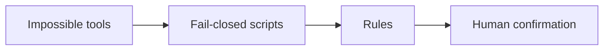

# Gainzbot

A fitness and nutrition coach that will not change your plan until the checks pass and you say yes.

## Who it is for

People who want training and food guidance with the safety checks in this repo.

## Four layers



Impossible tools: the bot cannot post, buy, or connect a service on its own.

Fail-closed scripts: missing or bad input stops the plan.

Rules: plain English for the coach. Rules guide, checks enforce.

Human confirmation: you say a clear yes to the exact plan.

## Primary gate

The check-in checklist comes first. `red_flag_check.scan_check_in` has to pass before a plan is checked. `record_confirmation` has to cover that exact plan before anything is applied.

Safety bounds: 1,500/1,200 kcal floors, 10% weekly load cap, 200 kcal max step, no calorie or protein targets under 18, under 13 rejected.

## What is built

- Shared input checks in `guardrails/validate.py`
- Red-flag check-in in `red_flag_check.py`
- Readiness screen in `readiness_screen.py`
- Plan bounds in `plan_check.py`
- Clear-yes confirmation in `record_confirmation.py`
- Chart data in `dashboard.py`. The builder only reads logs. A calorie target is left off when age or sex is missing, when the user is under 18, or when the target is below the floor (1,500 for men, 1,200 for women). When age is missing, or the user is under 18, no protein target is set. A protein target outside 1.6 to 2.2 g/kg is left off too. One log is not enough: the message stays "not enough data yet" until there are at least two. Windows are 7, 28, 90, and 365 days.
- Trend review in `trend_review.py`. The last confirmed load or calorie change comes from one shared history. A new change waits until that confirmed change is at least 7 times 24 hours old in UTC. With nothing confirmed, load and calories do not move up. `apply` waits until `record_confirmation` covers that exact proposal. A missing age blocks calorie and protein proposals. Under 18, no calorie target is proposed. A stall follows the goal: cut or lose lowers calories, gain raises them, hold or no goal changes nothing.
- Morning check-in in `morning_checkin.py`. Sleep, soreness, energy, and stress set the day to push, normal, or easy. The session scales from the last confirmed load, stays inside the 10 percent cap, and waits 7 times 24 hours. With nothing confirmed, the load does not move up. A caller planned load is ignored. A rewritten week is built from that confirmed load, so a day sent in at 200 does not come back at 220. An earlier day is capped at the confirmed load, so 200 becomes 100 and a deload at 80 stays 80. A missed date after the check is rejected. `apply` waits until `record_confirmation` covers that exact proposal.

- Photo food log in `photo_food_log.py`. `store_estimate` logs a meal only after `record_confirmation` covers that exact estimate. Each confirmation logs one meal. A single item over 3,000 kcal or over 300 g protein is rejected for a re-check, and a day stops at 10,000 kcal. When age is missing, or the user is under 18, no protein target is set. `usual breakfast` needs `record_confirmation`.
- Wearable import in `wearable_import.py`. Apple Health, a summary, and Garmin each need `record_confirmation` for that source. The Apple Health yes covers that export file, not every file. A bare true flag does not count. Weight outside 25 to 350 kg is rejected. More than 100,000 steps in a day is rejected. Sleep over 24 hours in a day is rejected. Workout minutes over 1,440 in a day are rejected. A future date is rejected. A summary date has to be a real date.
- Set logging in `set_logger.py`. The next weight comes from the last confirmed load. When that load cannot be read, there is no weight suggestion. Logging 100, then 121, then 133.1 with no history does not suggest 133.1. Logging 150 against a confirmed 100 that is under 7 days old stays at 100. A rise waits until that confirmed load is 7 times 24 hours old in UTC, and it is at most 10 percent. `apply` waits until `record_confirmation` covers that exact proposal.

## Tests

```bash
pytest -v
```

## Limits

This is not medical advice.

The checks catch mistakes. The result signing key is in the public repo, and the speaker is a caller-supplied string. A deliberate fake can still get through.

## License

MIT. See [LICENSE](LICENSE).
