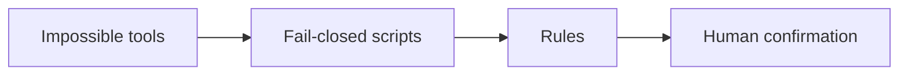

# Gainzbot

A fitness and nutrition coach that will not change your plan until the checks pass and you say yes.

## Who it is for

People who want training and food guidance with the safety checks in this repo.

## Four layers



Impossible tools: the bot cannot post, buy, or connect a service on its own.

Fail-closed scripts: missing or bad input stops the plan.

Rules: plain English for the coach. Rules guide, checks enforce.

Human confirmation: you say a clear yes to the exact plan.

## Primary gate

The check-in checklist comes first. `red_flag_check.scan_check_in` has to pass before a plan is checked. `record_confirmation` has to cover that exact plan before anything is applied.

Safety bounds: 1,500/1,200 kcal floors, 10% weekly load cap, 200 kcal max step, no calorie or protein targets under 18, under 13 rejected.

## What is built

- Shared input checks in `guardrails/validate.py`
- Red-flag check-in in `red_flag_check.py`
- Readiness screen in `readiness_screen.py`
- Plan bounds in `plan_check.py`
- Clear-yes confirmation in `record_confirmation.py`
- Chart data in `dashboard.py`. The builder only reads logs. A calorie target is left off when age or sex is missing, when the user is under 18, or when the target is below the floor (1,500 for men, 1,200 for women). When age is missing, or the user is under 18, no protein target is set. A protein target outside 1.6 to 2.2 g/kg is left off too. One log is not enough: the message stays "not enough data yet" until there are at least two. Windows are 7, 28, 90, and 365 days.

- Photo food log in `photo_food_log.py`. `store_estimate` logs a meal only after `record_confirmation` covers that exact estimate. A single item over 3,000 kcal or over 300 g protein is rejected for a re-check. Under 18, no protein target is set. `usual breakfast` logs a remembered meal in one line.

## Tests

```bash
pytest -v
```

## Limits

This is not medical advice.

The checks catch mistakes. The result signing key is in the public repo, and the speaker is a caller-supplied string. A deliberate fake can still get through.

## License

MIT. See [LICENSE](LICENSE).
